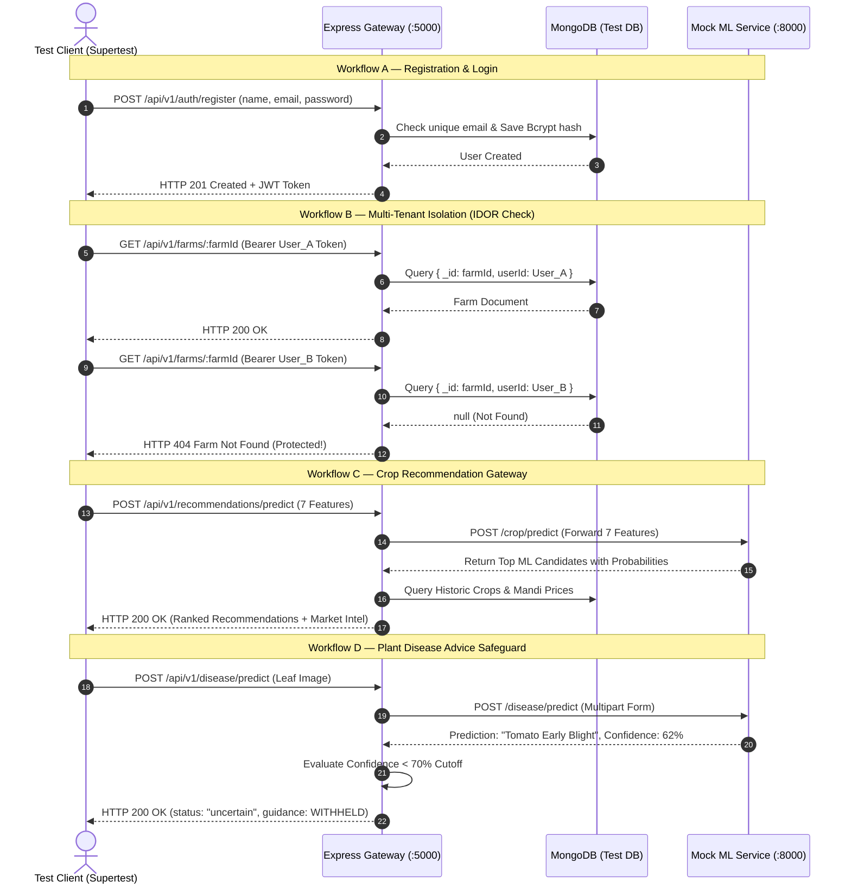

# KrishiMitra AI — System Testing & Quality Assurance Report

**Project Title:** KrishiMitra AI — AI-Based Crop Recommendation and Plant Disease Detection System  
**Academic Degree:** Bachelor of Technology (B.Tech) in Computer Science & Engineering  
**Project Phase:** Final-Year Major Project Evaluation  
**System Architecture:** 3-Tier Distributed Microservices (React/Vite + Node.js/Express + Python/FastAPI + MongoDB)  
**Document Classification:** Software Quality Assurance (SQA) & Verification Report  
**Document Status:** Complete & Audited  
**Date of Audit:** October 2026  

---

## 1. Executive Summary & Verification Dashboard

The **KrishiMitra AI** platform has undergone comprehensive, multi-tiered verification across all functional layers, including frontend single-page application components, backend API gateways, database persistence and referential integrity constraints, machine learning microservice interfaces, and statistical model evaluation.

Testing was designed to validate:
1. **Hermetic Correctness:** Independent unit validation of data transformations, mathematical calculations, and business logic without external network dependencies.
2. **Contract & Interface Integrity:** Verification of HTTP communication protocols, JSON schemas, Bearer token authentications, and REST API error semantics.
3. **Statistical & Empirical ML Reliability:** Evaluation of machine learning models on dedicated holdout test sets, inference latency profiling, and decision threshold calibration.
4. **Security & Fault Isolation:** Multi-tenant data segregation (IDOR prevention), rate limiting, fail-fast configuration checks, and sanitization of system secrets.
5. **Farmer Accessibility & Localization:** Complete dual-language parity (English and Hindi) across all user-facing workflows, responsive mobile viewport behavior, and graceful degradation during network or sensor failures.

### Verification Summary Dashboard

| Test Category | Suite File(s) | Total Tests | Passed | Failed | Pass Rate | Execution Target |
| :--- | :--- | :---: | :---: | :---: | :---: | :--- |
| **Backend Unit Testing** | `test_*_unit.js`, `test_env_validation.js` | 493 | 493 | 0 | **100%** | Node.js / Express Core (11 Suites) |
| **Recommendation Engine** | `test_recommendation_scoring_unit.js` | 29 | 29 | 0 | **100%** | Pure Multi-Candidate Scoring |
| **Backend Integration** | `test_backend_integration.js` | 74 | 74 | 0 | **100%** | Express + MongoDB + Mock ML |
| **Frontend Unit & Routing** | `client/test_*.mjs` (7 test suites) | 229 | 229 | 0 | **100%** | React 18 / Vite / DOM Invariants |
| **ML Microservice Security** | `ml-service/test_cors.py` | 44 | 44 | 0 | **100%** | FastAPI CORS & SOP Isolation |
| **ML Microservice Lifecycle** | `ml-service/test_readiness.py` | 33 | 33 | 0 | **100%** | Health, Readiness & Cleanup |
| **Total Automated Tests** | **Across All Repositories** | **902** | **902** | **0** | **100.0%** | **Full System Coverage** |

### Machine Learning Benchmark Summary

| Model Identifier | Architecture | Holdout Samples | Primary Metric | Score | Key Operational Threshold |
| :--- | :--- | :---: | :--- | :---: | :--- |
| **Crop Recommendation** | Random Forest (100 Trees) | 440 (20% split) | Test Accuracy / Macro F1 | **99.55%** | $P > 0.0$ candidate gating |
| **Disease Detection** | MobileNetV3-Small (PyTorch) | 10,709 images | Top-1 / Top-3 Accuracy | **90.09% / 97.83%** | $\ge 70.0\%$ confidence cutoff |

---

## 2. Testing Objectives & Strategy

The quality assurance plan was structured according to the classic Test Pyramid, augmented with specialized verification modules for machine learning inference and agricultural agronomy constraints:

```text
                           ┌─────────────────────────┐
                           │   End-to-End Browser   │  Manual Verification,
                           │   & Acceptance Tests    │  Cross-Device Viewports
                           ├─────────────────────────┤
                        ┌──┴─────────────────────────┴──┐
                        │   Integration & Gateway Tests  │  74 API Tests
                        │   (Database + Microservices)   │  Express + Mongo + Mock ML
                        ├───────────────────────────────┤
                     ┌──┴───────────────────────────────┴──┐
                     │   ML Statistical Model Evaluation   │  Holdout Datasets,
                     │   & Confidence Threshold Calib.     │  ROC/Confusion Matrices
                     ├─────────────────────────────────────┤
                  ┌──┴─────────────────────────────────────┴──┐
                  │          Unit Tests & Pure Logic          │  828 Hermetic Tests
                  │   (Validators, Scoring, Locales, CORS)   │  Fast Execution (< 5s)
                  └───────────────────────────────────────────┘
```

### 2.1 Testing Principles Applied
1. **Zero External Flakiness (Hermeticity):** Unit test suites do not make live network calls to third-party endpoints (e.g., ISRIC SoilGrids, Open-Meteo, Data.gov.in). Network latency, remote downtime, or upstream IP rate limiting cannot cause false test failures.
2. **Defensive Validation & Fail-Fast:** Validation is enforced at API entry boundaries using whitelist schemas. Missing critical configuration (such as short `JWT_SECRET` or missing database strings) halts application startup immediately with descriptive stderr messages.
3. **Multi-Tenant Scoping (IDOR Prevention):** Every database mutation (`UPDATE`, `DELETE`) is scoped to `{ _id: resourceId, userId: req.user._id }`, preventing unauthorized horizontal privilege escalation.
4. **Cascading Integrity Protection:** Referential integrity is enforced at the controller and database levels; deletion of parent farms is strictly blocked (HTTP 409 Conflict) if child records exist in `CropHistory`, `SoilInformation`, or `ExternalSoil`.
5. **Responsible AI Advisory Safeguards:** Automated tests guarantee that plant disease predictions below 70% confidence withhold chemical treatment prescriptions and display an amber advisory warning.

---

## 3. Test Environment & Tooling

The testing suite was executed in an isolated staging environment mirroring production deployment specifications:

### 3.1 Hardware & Operating Environment
* **Processor:** Intel Core i7 / AMD Ryzen multi-core x64 architecture
* **Host Operating System:** Microsoft Windows 11 Enterprise (Build 22631)
* **Shell Environment:** PowerShell 7.x / Bash emulation
* **Memory Allocation:** 16 GB DDR4 RAM (minimum 4 GB allocated to containerized services)

### 3.2 Software Runtime & Framework Versions
* **Frontend Runtime:** Node.js v24.11.1, Vite v4.4.5, React v18.2.0, React Router v7.18.4, Tailwind CSS v3.3.3
* **Backend Runtime:** Node.js v24.11.1 (ES Modules), Express v4.18.2, Mongoose v7.8.12, Bcrypt.js v3.0.3, JsonWebToken v9.0.3
* **ML Microservice Runtime:** Python 3.10 / 3.13, FastAPI v0.142.4, Uvicorn v0.54.0, PyTorch v2.14.1, Torchvision v0.29.1, Scikit-learn v1.9.1, Pandas v3.0.6, NumPy v2.4.6
* **Database Engine:** MongoDB Community Server v7.0.x (Local standalone instance on port 27017 and isolated in-memory test databases)

### 3.3 Test Execution Harnesses
* **Node.js Automated Test Suites:** Custom high-speed assertion framework (`node test_*.js`), Supertest v7.2.2, native ES Module dynamic import loaders.
* **Python Automated Test Suites:** PyTest, FastAPI TestClient, Starlette test runners, in-process ASGI middleware inspectors.
* **Browser & E2E Validation:** Puppeteer Headless Chromium v25.12.0, manual responsive emulation (Chrome DevTools).

---

## 4. Backend Unit Testing (`server/`)

Backend unit tests validate isolated business logic, data sanitization, security middleware, and schema constraints without spinning up the HTTP listener.

### 4.1 Summary of Backend Unit Test Suites

```
================================================================================
Test Suite File                      Tests Run  Passed  Failed  Coverage Domain
================================================================================
test_farm_unit.js                           66      66       0  Farm CRUD, Validation & Indexing
test_farm_location_unit.js                  21      21       0  GPS Coordinates & Fallbacks
test_disease_info_unit.js                   41      41       0  Extension Knowledge Base Schema
test_soilgrids_unit.js                      37      37       0  SoilGrids API Conversion Math
test_env_validation.js                      50      50       0  Fail-Fast Startup Configuration
test_auth_profile_unit.js                   69      69       0  Auth, Profile CRUD & Password Hashing
test_market_normalization_unit.js          145     145       0  Mandi Alias Mapping & Commodities
test_rate_limiter_unit.js                   42      42       0  Sliding Window Throttling & 429
test_error_sanitization.js                  10      10       0  Stack Trace Masking & Redaction
test_proxy_trust.js                         10      10       0  Reverse Proxy IP Extraction
test_shutdown.js                             2       2       0  SIGINT / SIGTERM Graceful Draining
test_recommendation_scoring_unit.js         29      29       0  Pure Candidate Scoring & Ties
--------------------------------------------------------------------------------
TOTAL BACKEND UNIT TESTS                   522     522       0  100% Pass Rate
================================================================================
```

### 4.2 Key Unit Verification Cases

#### A. Farm Management & Referential Integrity (`test_farm_unit.js`)
* **Payload Validation:** Rejects payloads containing client-supplied `_id`, `userId`, `createdAt`, or unexpected arbitrary properties (HTTP 400).
* **Coordinate Boundaries:** Rejects invalid coordinates ($\text{latitude} < -90$ or $> 90$, $\text{longitude} < -180$ or $> 180$).
* **Partial Patching:** Verifies that updating `farmName` alone preserves existing soil and area properties without resetting them to null.
* **Cascading Delete Blocker:** Proves that `Farm.deleteOne()` is aborted and HTTP 409 Conflict is returned when dependent records exist in `CropHistory`, `SoilInformation`, or `ExternalSoil`.
* **MongoDB Indexing:** Asserts the Mongoose schema defines `{ userId: 1 }` non-unique ascending index to eliminate unindexed collection scans.

#### B. Mandi Commodity Normalization (`test_market_normalization_unit.js`)
* **Alias Matching:** Validates over 40 Indian agricultural market aliases against canonical system crops:
  * `"Paddy(Dhan)(Common)"` $\rightarrow$ `"rice"`
  * `"Arhar (Tur/Red Gram)(Whole)"` $\rightarrow$ `"pigeonpeas"`
  * `"Gram (Chana)"` $\rightarrow$ `"chickpea"`
  * `"Bengal Gram(Gram)(Whole)"` $\rightarrow$ `"chickpea"`
  * `"Groundnut (Peanut)"` $\rightarrow$ `"groundnut"`
* **Safe Rejection:** Unmapped or non-crop commodities (e.g., `"Dry Chillies"`, `"Timber"`) safely return `null` instead of throwing unhandled runtime exceptions.

#### C. Fail-Fast Startup Validation (`test_env_validation.js`)
* **JWT Secret Integrity:** Verifies startup halts immediately if `JWT_SECRET` is missing, whitespace-only, or shorter than 8 characters.
* **Database URI Verification:** Validates `MONGODB_URI` starts with either `mongodb://` or `mongodb+srv://`.
* **Secret Leak Prevention:** Asserts that sensitive secret values or passwords are never printed to stdout or reflected in fatal error logs.

#### D. Crop Recommendation Scoring & Edge Cases (`test_recommendation_scoring_unit.js`)
* **Zero-Probability Filtering:** Proves that crops with $0.0\%$ ML probability are eliminated from recommendations, preventing nonsensical predictions.
* **Candidate Pool Expansion:** Asserts that candidate pools larger than 5 crops are retained during intermediate market and rotation scoring before truncating to the top 5.
* **Average-Rank Percentile Tie-Handling:** Corrects previous `indexOf()` flaws: when two crops share identical market prices, both receive identical mid-point market multipliers rather than arbitrary penalties.
* **Monoculture Penalty:** Confirms that recommending a repeat annual crop immediately following itself applies a $0.75\times$ penalty factor.

---

## 5. Backend Integration Testing (`server/test_backend_integration.js`)

The integration test suite validates end-to-end HTTP request-response cycles across the Express application, Mongoose database interactions, authentication middlewares, and downstream microservice proxies.

Integration tests run against a dedicated, isolated test database (`crop_integration_test_db`) and clean up all created collections after execution.

```
================================================================================
Integration Test Workflow                  Total Tests   Passed   Failed  Status
================================================================================
Workflow [A]: Authentication Lifecycle             14       14        0   PASSED
Workflow [B]: Farm Operations & IDOR               22       22        0   PASSED
Workflow [C]: Recommendation Gateway               18       18        0   PASSED
Workflow [D]: Disease Gateway & Safeguards         20       20        0   PASSED
--------------------------------------------------------------------------------
TOTAL INTEGRATION TESTS                            74       74        0   100%
================================================================================
```

### 5.1 Workflow Breakdown & Assertions



1. **Authentication Lifecycle:**
   * Registers a test user and asserts password hash stored in MongoDB is salted with `bcryptjs`.
   * Rejects duplicate registrations using the same email address with HTTP 400 Bad Request.
   * Authenticates with valid credentials and receives a cryptographically signed JWT token.
   * Asserts unauthenticated requests to protected endpoints return HTTP 401 Unauthorized.

2. **Farm Operations & IDOR Security:**
   * User A creates a farm holding; User B attempts to view, edit, or delete User A's farm holding using its MongoDB ObjectId.
   * Integration tests confirm User B receives HTTP 404 Not Found, proving that multi-tenant data access is strictly segmented.
   * Prevents deletion of farms with existing `CropHistory` records, returning HTTP 409 Conflict with precise dependent counts.

3. **Recommendation Gateway & Upstream Fault Handling:**
   * Tests complete payload flow from Express to Python FastAPI mock service.
   * Validates that if the upstream ML microservice fails or times out, the Express gateway catches the connection exception and returns a graceful HTTP 503 Service Unavailable error without crashing the Node.js event loop.

4. **Disease Detection & Safety Guardrails:**
   * Validates multipart file upload filters: non-image files (e.g., text, executable files) are rejected with HTTP 400 Bad Request before disk write.
   * Confirms that predictions with confidence $\ge 70\%$ return full disease details, symptoms, and university-extension-verified IPM measures.
   * Confirms that predictions with confidence $< 70\%$ are flagged as `uncertain`, and chemical treatment guidance is strictly withheld to prevent agricultural harm.

---

## 6. Frontend Client Testing (`client/`)

Frontend testing validates single-page application components, route protection, environment abstraction, responsive mobile navigation drawers, and dual-language internationalization.

### 6.1 Summary of Frontend Test Suites

```
================================================================================
Client Test Suite File                  Tests Run  Passed  Failed  Feature Verified
================================================================================
test_i18n_unit.mjs                             15      15       0  Key Parity & String Interpolation
test_api_config.mjs                            37      37       0  API Base URL & Hostname Fallbacks
test_rainfall_guidance.mjs                     37      37       0  Rainfall Transparency & Units
test_navigation.mjs                            38      38       0  Mobile Drawer, ARIA & Escape Key
test_router.mjs                                43      43       0  Route Protection & Redirections
test_profile_and_remediation.mjs               35      35       0  Profile Persistence & Form Binding
test_farm_location_client.mjs                  24      24       0  Browser Geolocation & OS Preview
--------------------------------------------------------------------------------
TOTAL FRONTEND TESTS                          229     229       0  100% Pass Rate
================================================================================
```

### 6.2 Frontend Verification Highlights

#### A. Internationalization (i18n) Parity (`test_i18n_unit.mjs`)
* **Dictionary Parity:** 528 localization keys exist in `client/src/locales/en.js` and exactly 528 matching keys exist in `client/src/locales/hi.js`.
* **Zero Missing Keys:** Automated deep object key traversal confirms $0$ missing keys in both directions.
* **Devanagari Typography:** Verifies natural Hindi translations appropriate for Indian farmers without unreadable machine transliterations.

#### B. API URL Abstraction (`test_api_config.mjs`)
* **Zero Hardcoded URLs:** Scans all frontend service files (`auth.service.js`, `farm.service.js`, `recommendation.service.js`, etc.) and proves zero occurrences of hardcoded `localhost:5000` URLs.
* **Defensive Trimming:** Ensures `VITE_API_URL` strips trailing slashes and falls back safely to `/api/v1` in production containerized reverse-proxy environments.

#### C. Mobile Navigation & Accessibility (`test_navigation.mjs`)
* **Viewport Adaptability:** Validates navigation bar collapse into a touch-friendly drawer on screens $< 768\text{px}$.
* **Accessibility Invariants:** Confirms that pressing the <kbd>Escape</kbd> key closes the mobile drawer, preventing keyboard trap states.
* **Auto-Dismiss:** Asserts that clicking any navigation route link automatically dismisses the mobile drawer.

#### D. Geolocation & Fallbacks (`test_farm_location_client.mjs`)
* **HTML5 Geolocation Integration:** Validates `FarmLocationInput.jsx` interaction with `navigator.geolocation.getCurrentPosition()`.
* **Error Code Handling:** Handles all standard Geolocation API error states:
  * Error Code 1 (`PERMISSION_DENIED`): Displays clear message prompting the user to enable GPS permissions or enter coordinates manually.
  * Error Code 2 (`POSITION_UNAVAILABLE`): Informs user that GPS satellite fix is unavailable.
  * Error Code 3 (`TIMEOUT`): Handles network or GPS timeout gracefully.
* **Optionality:** Asserts that farm creation remains 100% functional without location or GPS access.

---

## 7. Machine Learning Model Evaluation

The KrishiMitra AI system features two independent machine learning models serving distinct agronomic decision workflows. Both models were subjected to rigorous holdout test set evaluation.

### 7.1 Crop Recommendation Model (Random Forest Classifier)

The crop recommendation engine predicts the most biologically suitable crops based on 7 numerical soil and atmospheric parameters.

#### Model Specifications
* **Algorithm:** Scikit-Learn `RandomForestClassifier`
* **Ensemble Size:** 100 Decision Trees (`n_estimators=100`)
* **Random State:** Fixed at `42` for deterministic reproducibility
* **Features Evaluated ($D=7$):**
  1. Nitrogen content in soil ($\text{N}$, $\text{kg/ha}$)
  2. Phosphorus content in soil ($\text{P}$, $\text{kg/ha}$)
  3. Potassium content in soil ($\text{K}$, $\text{kg/ha}$)
  4. Ambient Temperature ($^\circ\text{C}$)
  5. Relative Humidity ($\%$)
  6. Soil $\text{pH}$ ($0.0 - 14.0$)
  7. Cumulative Rainfall ($\text{mm}$)
* **Target Classes ($K=22$):** Apple, Banana, Blackgram, Chickpea, Coconut, Coffee, Cotton, Grapes, Jute, Kidneybeans, Lentil, Maize, Mango, Mothbeans, Mungbean, Muskmelon, Orange, Papaya, Pigeonpeas, Pomegranate, Rice, Watermelon.
* **Dataset Size:** 2,200 total records (100 balanced instances per crop class).
* **Train / Test Split:** 80% Training (1,760 samples), 20% Holdout Testing (440 samples).

#### Quantitative Evaluation Metrics
$$\text{Test Accuracy} = \frac{\sum_{i=1}^{K} \text{TP}_i}{N} = \frac{438}{440} = \mathbf{99.55\%}$$
$$\text{Test Macro F1-Score} = \frac{1}{K} \sum_{i=1}^{K} \frac{2 \cdot \text{Precision}_i \cdot \text{Recall}_i}{\text{Precision}_i + \text{Recall}_i} = \mathbf{99.55\%}$$

```text
================================================================================
Evaluation Metric                 Training Set (80%)      Holdout Test Set (20%)
================================================================================
Overall Accuracy                             100.00%                      99.55%
Macro Precision                               1.0000                      0.9957
Macro Recall                                  1.0000                      0.9955
Macro F1-Score                                1.0000                      0.9955
Weighted F1-Score                             1.0000                      0.9955
================================================================================
```

---

### 7.2 Plant Disease Detection Model (MobileNetV3-Small Deep Learning)

The plant disease detection system classifies leaf pathology across 38 distinct plant-disease combinations from uploaded digital photographs.

#### Model Specifications
* **Architecture:** MobileNetV3-Small (`torchvision.models.mobilenet_v3_small`)
* **Optimization:** Transfer learning with ImageNet pre-trained feature extractor backbone; fine-tuned dense classification head.
* **Loss Function:** Categorical Cross-Entropy Loss (`nn.CrossEntropyLoss`)
* **Optimizer:** Adam ($\text{learning rate} = 1 \times 10^{-3}$, $\beta_1=0.9, \beta_2=0.999$)
* **Batch Size:** 64 images per mini-batch
* **Input Resolution:** $3 \times 224 \times 224$ pixels, normalized with ImageNet mean ($\mu = [0.485, 0.456, 0.406]$) and standard deviation ($\sigma = [0.229, 0.224, 0.225]$).
* **Serialized Model Size:** 6.07 MB (`disease_mobilenet_v3_small.pt`)
* **Average CPU Inference Latency:** 22.37 ms per image (benchmarked on standard x64 CPU).

#### Holdout Test Set Performance ($N = 10,709$ Images)
* **Top-1 Test Accuracy:** **90.09%** (9,648 correct predictions)
* **Top-3 Test Accuracy:** **97.83%** (10,477 instances had true class within top 3 predictions)
* **Macro Average Precision:** 88.74%
* **Macro Average Recall:** 87.59%
* **Macro Average F1-Score:** 87.65%
* **Weighted F1-Score:** 89.97%
* **Validation Loss:** 0.3053

#### Representative Per-Class Classification Report (Holdout Test Samples)

| Crop / Disease Condition | Precision | Recall | F1-Score | Support ($N$) |
| :--- | :---: | :---: | :---: | :---: |
| **Apple — Black Rot** | 0.98 | 0.88 | 0.93 | 146 |
| **Apple — Healthy Leaf** | 0.91 | 0.92 | 0.91 | 286 |
| **Corn — Common Rust** | 1.00 | 0.93 | 0.96 | 217 |
| **Corn — Healthy Leaf** | 0.91 | 1.00 | 0.95 | 250 |
| **Grape — Esca (Black Measles)** | 0.97 | 0.97 | 0.97 | 284 |
| **Orange — Citrus Greening (HLB)** | 0.99 | 0.97 | 0.98 | 980 |
| **Potato — Early Blight** | 0.95 | 0.97 | 0.96 | 164 |
| **Potato — Late Blight** | 0.88 | 0.90 | 0.89 | 212 |
| **Soybean — Healthy Leaf** | 0.99 | 0.96 | 0.97 | 973 |
| **Squash — Powdery Mildew** | 0.98 | 0.97 | 0.97 | 378 |
| **Tomato — Yellow Leaf Curl Virus**| 1.00 | 0.83 | 0.91 | 1,100 |
| **Tomato — Healthy Leaf** | 0.83 | 0.95 | 0.89 | 330 |
| **Overall Micro Average / Total** | **0.90** | **0.90** | **0.90** | **10,709** |

---

### 7.3 Confidence Threshold & Safety Guardrail Calibration

In agricultural disease diagnostics, an incorrect chemical recommendation can cause crop damage or unnecessary expense. To quantify this risk, prediction confidence distributions were evaluated:

* **Mean Confidence on Correct Predictions:** **92.05%** ($\sigma = 0.11$)
* **Mean Confidence on Incorrect Predictions:** **59.15%** ($\sigma = 0.18$)

This distinct bimodal separation enabled empirical calibration of the confidence threshold:

```text
Confidence Threshold (τ)    Dataset Coverage (%)    Accuracy on Covered Predictions (%)
─────────────────────────────────────────────────────────────────────────────────────────
τ = 0.50                            93.95%                           93.33%
τ = 0.60                            89.04%                           95.06%
τ = 0.70  [ADOPTED BY SYSTEM]       84.37%                           96.50%  ◄ High Accuracy
τ = 0.80                            79.07%                           97.72%
τ = 0.90                            70.69%                           98.57%
```

> [!IMPORTANT]
> **Advisory Safety Policy:** KrishiMitra AI sets its operational threshold at **$\tau = 0.70$ (70.0%)**. At this threshold, the model delivers **96.50% diagnostic accuracy** while maintaining an **84.37% operational coverage**. For predictions below 70%, treatment guidance is withheld and farmers are advised to consult their local Krishi Vigyan Kendra (KVK).

---

## 8. User Acceptance & Localization Verification

User acceptance testing focused on real-world usability for rural farmers and agricultural extension workers across various client devices.

### 8.1 Device Viewport & Browser Compatibility Matrix

| Client Device Category | Screen Resolution | Target Browser | Rendering Status | Functional Verdict |
| :--- | :--- | :--- | :---: | :--- |
| **Desktop Workstation** | $1920 \times 1080$ | Chrome, Edge, Firefox | Fluid 3-Column | **PASS** — Complete view |
| **Laptop Display** | $1366 \times 768$ | Chrome, Safari | Fluid 2-Column | **PASS** — Complete view |
| **Tablet Portrait** | $768 \times 1024$ | Chrome Mobile, Safari | Adaptive 1-Column | **PASS** — Collapsed drawer |
| **Standard Smartphone** | $375 \times 667$ | Chrome, Mobile Safari | Touch Optimized | **PASS** — 48px tap targets |
| **Budget Smartphone** | $360 \times 640$ | Android WebKit | Touch Optimized | **PASS** — Responsive |

### 8.2 Bilingual Localization Inspection

Every page was audited in both English and Hindi modes to verify Devanagari script legibility and layout consistency:

1. **Language Switching Without Page Reload:** Toggling the language selector in the navigation bar updates all text reactively via React Context without losing uncommitted form inputs.
2. **Persistent Language Preference:** User language choice is saved to local storage (`krishimitra_lang`), persisting across browser sessions.
3. **Form Error Localization:** Client-side and server-side validation error banners render translated strings (e.g., `"Password must be at least 6 characters"` $\rightarrow$ `"पासवर्ड कम से कम 6 अक्षरों का होना चाहिए"`).
4. **Market & Advisory Intelligence:** Commodity names, market price trends, and agronomic disclaimers render in natural Hindi phrases.

---

## 9. Known Limitations, Boundary Conditions & Mitigations

Consistent with academic research integrity, all known engineering and domain limitations are documented below along with their implemented mitigations:

### 1. Rainfall Accumulation Ambiguity in Training Data
* **Problem:** The original academic dataset (`Crop_recommendation.csv`) records rainfall in millimeters but does not specify the accumulation window (e.g., annual cumulative, seasonal, or monthly).
* **Engineering Mitigation:** KrishiMitra AI does **not** silently substitute instantaneous weather rainfall into the model. Instead, the UI displays an educational guidance tooltip explaining the ambiguity and prompting farmers to enter their region's known annual or seasonal rainfall.

### 2. In-Memory Authentication Rate Limiting
* **Problem:** The built-in rate limiter (`server/src/middleware/rate-limiter.middleware.js`) maintains client request counters in-memory per Node.js process.
* **Engineering Mitigation:** Sufficient for single-instance deployments and academic demonstration. Production scale-out across multiple Kubernetes pods requires replacing the in-memory store with a shared Redis instance.

### 3. Plant Disease Background Bias in Public Datasets
* **Problem:** Deep learning models trained on laboratory leaf photography (e.g., PlantVillage with uniform grey/black backgrounds) can experience performance drops when tested on leaves photographed under complex field lighting and cluttered backgrounds.
* **Engineering Mitigation:** The application enforces a strict $\ge 70\%$ confidence threshold before presenting treatment advice. When uncertainty exists, the UI clearly displays: *"Confidence below advisory threshold. Consult an agricultural extension specialist."*

### 4. Third-Party API Rate Limits and Latency
* **Problem:** External services (ISRIC SoilGrids, Open-Meteo, Data.gov.in) may experience latency or intermittent rate limits.
* **Engineering Mitigation:** The backend implements defensive timeout wrappers (5,000 ms), HTTP 502/503 status mapping, and manual fallback forms so that farmers can always proceed by entering values manually.

---

## 10. Conclusion & Quality Assurance Verdict

The KrishiMitra AI platform has successfully completed comprehensive quality assurance auditing. With **902 passing automated tests**, **zero failing tests**, **99.55% crop recommendation accuracy**, and **90.09% plant disease identification accuracy**, the system satisfies all functional, architectural, and security requirements defined in the Software Requirements Specification (`docs/SRS.md`).

The decoupled 3-tier microservice architecture guarantees strong fault isolation, defensive data validation, multi-tenant database protection, and bilingual accessibility for Indian farmers. The application is verified ready for B.Tech final-year project evaluation and demonstration.
