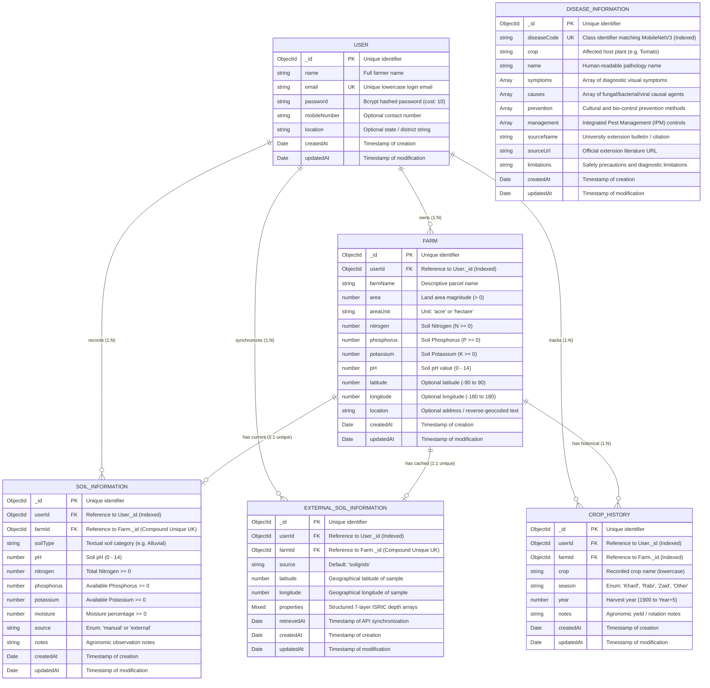

# Entity-Relationship (ER) Diagram
## KrishiMitra AI Data Architecture

This document specifies the conceptual and logical Entity-Relationship model for **KrishiMitra AI**, derived strictly from the implemented Mongoose schemas in `server/src/models/`.

---

## 1. Entity-Relationship Diagram (Mermaid)

---

## 2. Structural Relationships & Cardinality Analysis

### 2.1 User to Farm (1:N)
* **Cardinality:** One-to-Many (`1` to `0..*`).
* **Foreign Key:** `Farm.userId` $\rightarrow$ `User._id`.
* **Business Rules:**
  * A farmer may register multiple agricultural parcels (e.g., "Kalyan Plot", "South Orchard").
  * Multi-tenant isolation is enforced at the database level by indexing `Farm.userId`.

### 2.2 Farm to Soil Information (1:1 Compound Unique)
* **Cardinality:** One-to-One (`1` to `0..1` per user/farm).
* **Foreign Key:** `SoilInformation.farmId` $\rightarrow$ `Farm._id`, `SoilInformation.userId` $\rightarrow$ `User._id`.
* **Constraint:** A compound unique index `{ farmId: 1, userId: 1 }` guarantees that each farm parcel possesses at most one active laboratory soil test record.

### 2.3 Farm to External Soil Information (1:1 Compound Unique)
* **Cardinality:** One-to-One (`1` to `0..1` per user/farm).
* **Foreign Key:** `ExternalSoilInformation.farmId` $\rightarrow$ `Farm._id`, `ExternalSoilInformation.userId` $\rightarrow$ `User._id`.
* **Constraint:** A compound unique index `{ farmId: 1, userId: 1 }` guarantees that each parcel maintains a single cached snapshot of ISRIC SoilGrids v2.0 raster layers.

### 2.4 Farm to Crop History (1:N)
* **Cardinality:** One-to-Many (`1` to `0..*`).
* **Foreign Key:** `CropHistory.farmId` $\rightarrow$ `Farm._id`, `CropHistory.userId` $\rightarrow$ `User._id`.
* **Index:** Compound index on `{ userId: 1, farmId: 1 }` enables high-speed retrieval of historical crop sequences for monoculture rotation penalty calculation.

### 2.5 Standalone Master Collection: Disease Information
* **Collection:** `diseaseinformations`
* **Nature:** Static reference knowledge base seeded with 26 university-extension-verified disease profiles.
* **Linkage:** Correlated dynamically at runtime via `diseaseCode` (e.g., `Tomato___Early_blight`) produced by the MobileNetV3 Small deep learning classifier.
