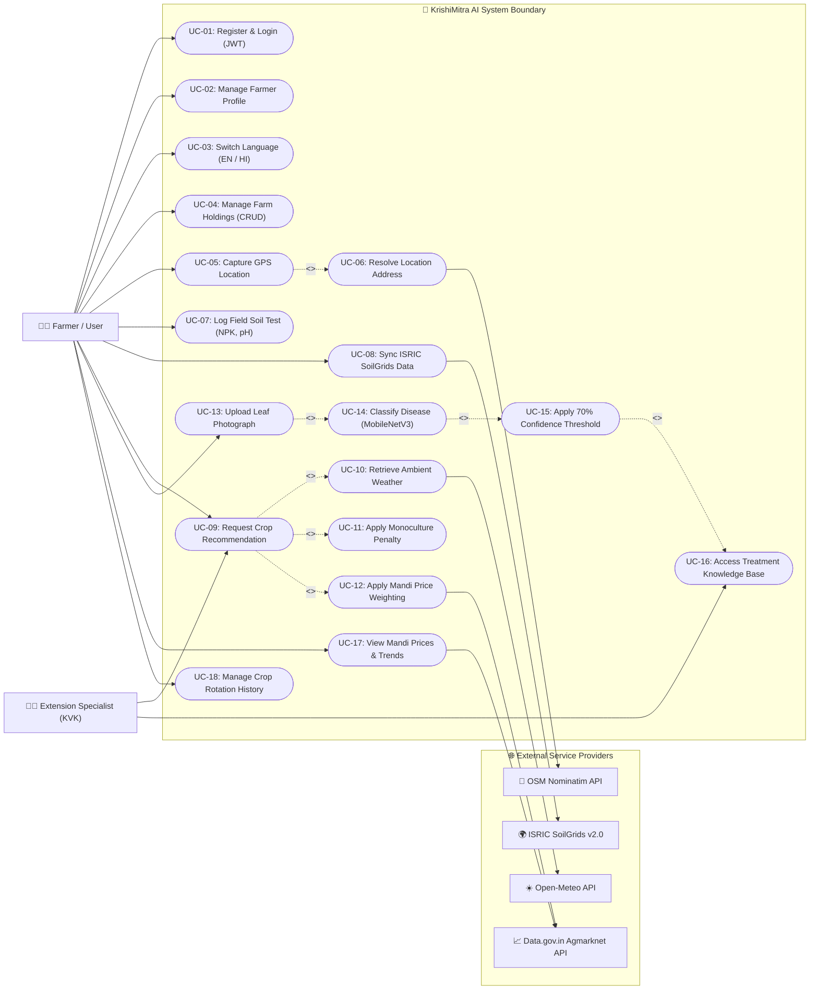

# UML Use Case Diagram & Specification
## KrishiMitra AI Platform

This document describes the primary actors, functional use cases, and interaction boundaries of the **KrishiMitra AI** platform.

---

## 1. Actors

| Actor | Type | Description |
| :--- | :--- | :--- |
| **Farmer / User** | Primary Human Actor | Agricultural landholder, tenant farmer, or agronomist seeking crop recommendations, disease diagnosis, and market rates. |
| **Agricultural Extension Specialist (KVK)** | Secondary Human Actor | Agronomist or extension officer reviewing AI recommendations and providing ground-level validation to farmers. |
| **Open-Meteo API** | External System Actor | Third-party REST service supplying real-time ambient temperature and relative humidity metrics. |
| **ISRIC SoilGrids v2.0 API** | External System Actor | Global soil data infrastructure providing raster soil chemistry (pH, nitrogen, organic carbon, texture, bulk density). |
| **Agmarknet / Data.gov.in API** | External System Actor | Government of India open data repository providing daily wholesale APMC mandi commodity prices and arrival volumes. |
| **OSM Nominatim API** | External System Actor | OpenStreetMap reverse-geocoding service translating latitude and longitude coordinates into administrative village, district, and state names. |

---

## 2. Use Case Diagram (Mermaid)

---

## 3. Detailed Use Case Descriptions

### UC-04: Manage Farm Holdings
* **Primary Actor:** Farmer
* **Precondition:** User is authenticated with a valid JWT token.
* **Main Success Scenario:**
  1. Farmer navigates to the Farm Management section.
  2. Farmer enters parcel name, area, area unit (`acre` or `hectare`), baseline soil chemistry (N, P, K, pH), and optional coordinates.
  3. System validates boundaries (e.g. Area $> 0$, $0 \le \text{pH} \le 14$).
  4. Parcel is persisted under `farms` collection with strict tenant isolation (`userId: req.user.id`).
* **Extensions:**
  * If farmer attempts to delete a farm that has associated Crop History or Soil records, system blocks deletion and returns HTTP 409 Conflict with dependent record counts.

### UC-05 & UC-06: Capture GPS Location & Reverse Geocoding
* **Primary Actor:** Farmer
* **Precondition:** Farmer is on the Farm Creation/Edit screen on a GPS-capable mobile or desktop browser.
* **Main Success Scenario:**
  1. Farmer clicks "Use My Location (GPS)".
  2. Browser prompts for location permission.
  3. Geolocation API retrieves high-accuracy latitude and longitude coordinates.
  4. Frontend auto-fills the latitude and longitude inputs.
  5. Backend queries OpenStreetMap Nominatim reverse-geocoder to auto-resolve village, district, and state.
* **Extensions:**
  * If user denies permission, times out, or GPS is unavailable, user can enter coordinates manually or leave location blank without blocking farm registration.

### UC-09: Request Multi-Factor Crop Recommendation
* **Primary Actor:** Farmer
* **Precondition:** User has provided soil NPK, pH, Temperature, Humidity, and Rainfall.
* **Main Success Scenario:**
  1. User selects a farm parcel (auto-populating soil NPK and pH) or inputs parameters manually.
  2. User clicks "Get Weather" to retrieve real-time temperature and humidity from Open-Meteo.
  3. User enters expected seasonal rainfall (mm).
  4. System dispatches canonical 7-feature vector to Python FastAPI microservice.
  5. Random Forest model computes class probabilities across 22 crops.
  6. ML service filters out zero-probability crops and returns all candidates with positive probabilities.
  7. Node.js backend checks `CropHistory` for historical monoculture penalties ($0.75$ for same annual crop).
  8. Node.js backend retrieves Mandi price data from Data.gov.in, ranks candidate prices by tie-aware percentiles, and applies market factors ($0.95$ to $1.05$).
  9. System calculates composite Final Score using full floating-point precision, sorts deterministically (Score $\rightarrow$ Probability $\rightarrow$ Alphabetical), and presents top 5 recommendations.

### UC-13 to UC-16: Plant Leaf Disease Detection & Verified Guidance
* **Primary Actor:** Farmer
* **Precondition:** Farmer has captured a clear photograph of an affected crop leaf.
* **Main Success Scenario:**
  1. Farmer uploads a leaf photo (JPEG, PNG, WebP $\le 5\text{ MB}$).
  2. Node.js validates image format and streams multipart payload to Python FastAPI ML service.
  3. MobileNetV3 Small neural network resizes image to $224\times224$ and executes inference across 38 classes.
  4. System computes softmax confidence score.
  5. If confidence $\ge 70\%$, prediction status is set to `confident`.
  6. System queries `diseaseinformations` collection to append university-extension-verified disease profile (symptoms, cultural prevention, chemical management).
  7. Results are rendered with clear advisory notices.
* **Extensions:**
  * If confidence $< 70\%$, prediction status is set to `uncertain`. The system safely withholds chemical recommendations and advises the farmer to retake the photo under better lighting or consult a local KVK agronomist.

### UC-17: View Mandi Commodity Prices & Intelligence
* **Primary Actor:** Farmer
* **Precondition:** User selects state and optional district.
* **Main Success Scenario:**
  1. System queries Data.gov.in Agmarknet API.
  2. Commodities are mapped to canonical English/scientific labels.
  3. Stale records ($> 30$ days) are flagged.
  4. Prices within the district are aggregated using median modal pricing.
  5. Price trends (rising/falling/stable) and demand signals (high/moderate/low) are displayed.

### UC-03: Switch Application Language
* **Primary Actor:** Farmer
* **Precondition:** Any application screen is loaded.
* **Main Success Scenario:**
  1. User selects English or Hindi (`हिंदी`) from the navbar dropdown.
  2. Client-side localization context updates all text keys instantly without reloading the page.
  3. Preference is stored in browser `localStorage`.
