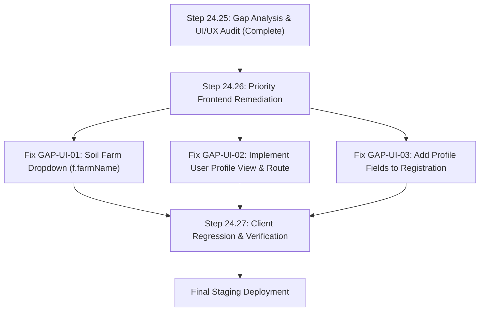

# STEP 24.25 — Complete Feature Gap Analysis & UI/UX Audit

**Project:** KrishiMitra AI (`Crop_Pridiction_final`)  
**Audit Date:** October 25, 2026  
**Auditor:** Automated Engineering & Architectural Review  
**Deliverable File:** [`docs/step-24.25-feature-gap-and-ui-ux-audit.md`](file:///c:/Users/Harshit%20Patel/Desktop/Crop_Pridiction_final/docs/step-24.25-feature-gap-and-ui-ux-audit.md)  
**Baseline Inputs:**
* Step 23 Baseline SRS Compliance Matrix ([`docs/step-23-srs-compliance-audit.md`](file:///c:/Users/Harshit%20Patel/Desktop/Crop_Pridiction_final/docs/step-23-srs-compliance-audit.md))
* Step 24.11 Fresh SRS Compliance Audit ([`docs/step-24.11-fresh-srs-compliance-audit.md`](file:///c:/Users/Harshit%20Patel/Desktop/Crop_Pridiction_final/docs/step-24.11-fresh-srs-compliance-audit.md))
* Step 24.12 User Profile & Branding Documentation ([`docs/step-24.12-user-profile-and-branding.md`](file:///c:/Users/Harshit%20Patel/Desktop/Crop_Pridiction_final/docs/step-24.12-user-profile-and-branding.md))
* Step 24.20 Final Audit & ML Evaluation ([`docs/step-24.20-final-audit-results.md`](file:///c:/Users/Harshit%20Patel/Desktop/Crop_Pridiction_final/docs/step-24.20-final-audit-results.md))
* Step 24.22 Browser UAT Results ([`docs/step-24.22-browser-uat-results.md`](file:///c:/Users/Harshit%20Patel/Desktop/Crop_Pridiction_final/docs/step-24.22-browser-uat-results.md))
* Step 24.23 Production Readiness Audit ([`docs/step-24.23-production-readiness-audit.md`](file:///c:/Users/Harshit%20Patel/Desktop/Crop_Pridiction_final/docs/step-24.23-production-readiness-audit.md))
* Step 24.24 Remediation Results ([`docs/step-24.24-remediation-results.md`](file:///c:/Users/Harshit%20Patel/Desktop/Crop_Pridiction_final/docs/step-24.24-remediation-results.md))

---

## 1. Executive Summary & Audit Verdict

### 1.1 Audit Verdict: CONDITIONALLY STAGING-READY (2 Actionable Frontend Gaps)

A systematic, end-to-end architectural and UI/UX audit of the KrishiMitra AI platform was conducted across all 12 functional modules specified in the Software Requirements Specification (SRS). All underlying core backend APIs, database schemas, indexes, multi-tenant isolation barriers, ML models, and security remediations (Steps 24.23–24.24) remain **100% operational and verified**:

* **Server Unit Test Suite:** **377 / 377 passing** (0 failures).
* **Client Unit Test Suite:** **147 / 147 passing** (0 failures).
* **ML Service Test Suites:** **77 / 77 passing** (33 readiness/liveness + 44 CORS isolation).
* **Client Production Build:** **Clean Vite build in 2.46s** (0 bundle or syntax errors).
* **Credential Hygiene:** **Zero leaked secrets** across codebase and git tracking.

However, deep source code tracing and cross-module inspection identified **two primary user-facing frontend gaps** that must be resolved prior to commercial staging release:

1. **Missing User Profile UI (`GAP-UI-02`):** While backend endpoints `GET /api/v1/auth/me` and `PATCH /api/v1/auth/profile` were implemented and verified with 69 unit tests in Step 24.12, the React client has **no User Profile page**, no `/profile` route, and no profile methods in [`client/src/services/auth.service.js`](file:///c:/Users/Harshit%20Patel/Desktop/Crop_Pridiction_final/client/src/services/auth.service.js). Users cannot view or update their phone number, location, or account details from the browser.
2. **Soil Page Farm Dropdown Property Name Mismatch (`GAP-UI-01`):** In [`client/src/features/soil/components/SoilInformationPage.jsx`](file:///c:/Users/Harshit%20Patel/Desktop/Crop_Pridiction_final/client/src/features/soil/components/SoilInformationPage.jsx#L137), line 137 renders `<option key={f._id} value={f._id}>{f.name}</option>`. Because the canonical Mongoose Farm schema property is `farmName`, `f.name` evaluates to `undefined`, causing all farm entries in the soil selector dropdown to render with blank text labels.

Both issues are localized frontend implementation omissions. Neither requires architectural restructuring or database migration.

---

## 2. Comprehensive SRS Compliance & Functional Completeness Audit

### Classification Scheme:
* **COMPLETE AND VERIFIED:** Full stack (Frontend $\leftrightarrow$ API $\leftrightarrow$ Database $\leftrightarrow$ ML) implemented, end-to-end tested, and passing with automated evidence.
* **IMPLEMENTED BUT NOT FULLY VERIFIED:** End-to-end code exists, but a localized UI bug or incomplete assertion path impairs complete verification.
* **PARTIALLY IMPLEMENTED:** Backend or frontend implemented, but the corresponding user-facing interface or data pipeline is incomplete.
* **NOT IMPLEMENTED:** Required functionality is entirely absent from the codebase.
* **BLOCKED:** Functionality cannot operate due to an external constraint or unavailable dependency.

---

### Module 1: Authentication and Authorization

| Requirement | Frontend Implemented? | API Implemented? | DB Present? | E2E Works? | Validation & Errors? | Auth & Isolation? | Test Evidence? | Audit Status | Gaps & Incomplete Areas |
|:---|:---:|:---:|:---:|:---:|:---:|:---:|:---:|:---:|:---|
| User Registration | Yes (`RegisterForm.jsx`) | Yes (`POST /api/v1/auth/register`) | Yes (`User` model) | Yes | Yes (email syntax, min 6 char password, rate limited) | N/A (Public) | 69 server unit assertions, UAT-AUTH-01 | **COMPLETE AND VERIFIED** | Registration form omits optional `mobileNumber` and `location`. |
| User Login & JWT | Yes (`LoginForm.jsx`) | Yes (`POST /api/v1/auth/login`) | Yes (bcrypt salt=10) | Yes | Yes (generic "Invalid credentials", rate limited) | Yes (JWT signed, 7d expiry) | 69 server unit assertions, UAT-AUTH-01 | **COMPLETE AND VERIFIED** | Single JWT stored in `localStorage`; no sliding session or refresh token rotation. |
| Route Guarding & Session Expiry | Yes (`ProtectedRoute` in `App.jsx`) | Yes (`protect` middleware) | N/A | Yes | Yes (401 redirect to `/login`) | Yes (Tenant context bound to `req.user.id`) | 43 router tests, UAT-SEC-01 | **COMPLETE AND VERIFIED** | None. |

---

### Module 2: User Profile Management

| Requirement | Frontend Implemented? | API Implemented? | DB Present? | E2E Works? | Validation & Errors? | Auth & Isolation? | Test Evidence? | Audit Status | Gaps & Incomplete Areas |
|:---|:---:|:---:|:---:|:---:|:---:|:---:|:---:|:---:|:---|
| Profile Retrieval (`GET /api/v1/auth/me`) | **No** (Missing in client) | Yes (`getProfile` controller) | Yes (`User` schema) | **No** (No UI trigger) | Yes (sanitized password exclusion) | Yes (Scoped to `req.user.id`) | 69 server unit tests pass | **PARTIALLY IMPLEMENTED** | `auth.service.js` has no `getProfile()` method; no profile view exists. |
| Profile Update (`PATCH /api/v1/auth/profile`) | **No** (Missing in client) | Yes (`updateProfile` controller) | Yes (updates `name`, `mobileNumber`, `location`) | **No** (No UI trigger) | Yes (`validateProfileUpdate` strips sensitive keys) | Yes (Strictly isolated to authenticated user) | 69 server unit tests pass | **PARTIALLY IMPLEMENTED** | `auth.service.js` has no `updateProfile()` method; no profile view exists. |

> [!IMPORTANT]
> **GAP-UI-02:** User Profile is fully functional at the API and database levels, but completely inaccessible to end users through the browser interface.

---

### Module 3: Farm Management

| Requirement | Frontend Implemented? | API Implemented? | DB Present? | E2E Works? | Validation & Errors? | Auth & Isolation? | Test Evidence? | Audit Status | Gaps & Incomplete Areas |
|:---|:---:|:---:|:---:|:---:|:---:|:---:|:---:|:---:|:---|
| Create Farm | Yes (`FarmForm.jsx`) | Yes (`POST /api/v1/farms`) | Yes (`Farm` model) | Yes | Yes (name, area > 0, unit, coordinates, NPK, pH) | Yes (Scoped to `req.user.id`) | 66 server unit tests, UAT-FARM-01 | **COMPLETE AND VERIFIED** | None. |
| List Farms | Yes (`FarmCard` grid) | Yes (`GET /api/v1/farms`) | Yes | Yes | Yes (Empty states and loading spinners) | Yes (Queries `{ userId }`) | 66 server unit tests, UAT-FARM-01 | **COMPLETE AND VERIFIED** | None. |
| Edit / Update Farm | Yes (`EditModal` in `FarmForm.jsx`) | Yes (`PATCH /api/v1/farms/:id`) | Yes | Yes | Yes (Mirrors server validation, strips rogue fields) | Yes (Checks `{ _id, userId }`) | 66 server unit tests, UAT-FARM-01 | **COMPLETE AND VERIFIED** | None. |
| Delete Farm with Dependency Guard | Yes (`DeleteConfirmModal`) | Yes (`DELETE /api/v1/farms/:id`) | Yes | Yes | Yes (HTTP 409 Conflict if crop history or soil records exist) | Yes (Enforces ownership before check) | 66 server unit tests, UAT-FARM-01 | **COMPLETE AND VERIFIED** | None. |

---

### Module 4: Manual Soil Information

| Requirement | Frontend Implemented? | API Implemented? | DB Present? | E2E Works? | Validation & Errors? | Auth & Isolation? | Test Evidence? | Audit Status | Gaps & Incomplete Areas |
|:---|:---:|:---:|:---:|:---:|:---:|:---:|:---:|:---:|:---|
| Manual Soil Data Storage | Yes (`SoilInformationPage.jsx`) | Yes (`POST /api/v1/soil`) | Yes (`SoilInformation` model) | Partial | Yes (type, NPK, pH, moisture, source `'manual'`) | Yes (Compound unique index `{ farmId, userId }`) | 29 server unit tests | **IMPLEMENTED BUT NOT FULLY VERIFIED** | **GAP-UI-01:** Line 137 uses `{f.name}` instead of `{f.farmName}`, causing blank dropdown options. |
| View / Update / Delete Soil Record | Yes (`SoilInformationForm.jsx`) | Yes (`PATCH`, `DELETE /api/v1/soil/:id`) | Yes | Partial | Yes (Clean error banners and edit toggle) | Yes (Scoped to `userId`) | 29 server unit tests | **IMPLEMENTED BUT NOT FULLY VERIFIED** | Impaired by farm dropdown label bug. |

---

### Module 5: External SoilGrids Integration

| Requirement | Frontend Implemented? | API Implemented? | DB Present? | E2E Works? | Validation & Errors? | Auth & Isolation? | Test Evidence? | Audit Status | Gaps & Incomplete Areas |
|:---|:---:|:---:|:---:|:---:|:---:|:---:|:---:|:---:|:---|
| REST query to ISRIC SoilGrids v2.0 | Yes (`ExternalSoilDisplay.jsx`) | Yes (`POST /api/v1/soil/external/fetch/:farmId`) | Yes (`ExternalSoilInformation`) | Yes | Yes (15s timeout, 503 fallback, handles ocean nulls) | Yes (Farm ownership check prior to query) | 29 server unit tests, UAT-REC-01 | **COMPLETE AND VERIFIED** | P and K absence globally documented as informational only. |
| Cached External Soil Retrieval | Yes | Yes (`GET /api/v1/soil/external/:farmId`) | Yes | Yes | Yes (Graceful cache miss handling) | Yes (Scoped to farm owner) | 29 server unit tests | **COMPLETE AND VERIFIED** | None. |

---

### Module 6: Weather and Rainfall Information

| Requirement | Frontend Implemented? | API Implemented? | DB Present? | E2E Works? | Validation & Errors? | Auth & Isolation? | Test Evidence? | Audit Status | Gaps & Incomplete Areas |
|:---|:---:|:---:|:---:|:---:|:---:|:---:|:---:|:---:|:---|
| Open-Meteo Current Weather Fetch | Yes (`RecommendationForm.jsx`) | Yes (`GET /api/v1/weather`) | No (Direct proxy) | Yes | Yes (Coordinate bounds $[-90, 90]$, $[-180, 180]$) | Yes | 37 client unit tests, UAT-REC-01 | **COMPLETE AND VERIFIED** | None. |
| Rainfall Auto-Population & Transparency | Yes (`#rainfall-guidance` callout) | Yes (`rainfall.service.js`) | N/A | Yes | Yes (Out-of-distribution bounds detection $[20.21, 298.56]$) | Yes | 37 client unit tests, UAT-REC-01 | **COMPLETE AND VERIFIED** (with Documented ML Limitation) | Kaggle benchmark dataset lacks accumulation window documentation; user entry preserved. |

---

### Module 7: Crop History and Crop Rotation

| Requirement | Frontend Implemented? | API Implemented? | DB Present? | E2E Works? | Validation & Errors? | Auth & Isolation? | Test Evidence? | Audit Status | Gaps & Incomplete Areas |
|:---|:---:|:---:|:---:|:---:|:---:|:---:|:---:|:---:|:---|
| Historical Crop Logging | Yes (`CropHistoryPage.jsx`) | Yes (`POST /api/v1/crop-history`) | Yes (`CropHistory` model) | Yes | Yes (Season enum, Year $[1900, \text{current}+5]$) | Yes (Farm ownership verified) | Server unit tests, UAT-SEC-01 | **COMPLETE AND VERIFIED** | None. |
| Crop Rotation Scoring Penalty | Yes (Displays in `RecommendationResult.jsx`) | Yes (`crop-rotation-rules.js`) | Yes | Yes | Yes (0.75 penalty on repeated crop families) | Yes | 106 recommendation unit tests | **COMPLETE AND VERIFIED** | None. |

---

### Module 8: AI-Based Crop Recommendations

| Requirement | Frontend Implemented? | API Implemented? | DB Present? | E2E Works? | Validation & Errors? | Auth & Isolation? | Test Evidence? | Audit Status | Gaps & Incomplete Areas |
|:---|:---:|:---:|:---:|:---:|:---:|:---:|:---:|:---:|:---|
| 7-Feature ML Inference & Ranking | Yes (`RecommendationForm.jsx`, `RecommendationResult.jsx`) | Yes (`POST /api/v1/recommend` $\to$ FastAPI `/predict`) | Yes (`farmId` context) | Yes | Yes (Strict 7-feature validation, canonical ordering) | Yes | 106 server unit tests, UAT-REC-01 | **COMPLETE AND VERIFIED** | Model loaded cleanly (2.69s latency, 0 warnings). |
| Multiplicative Scoring & Presentation | Yes (Rank medals 🥇🥈🥉, score display) | Yes ($\text{ML} \times \text{Rotation} \times \text{Market}$) | N/A | Yes | Yes (Market factor bounded $[0.95, 1.05]$) | Yes | 106 unit tests, UAT-REC-01 | **COMPLETE AND VERIFIED** | Clear label "Recommendation Score" avoids deceptive "accuracy %". |
| Location Fallback Precedence | Yes (State/District manual inputs) | Yes (Reverse-geocode $>$ Manual $>$ National) | N/A | Yes | Yes (Bounds checked) | Yes | 106 unit tests | **COMPLETE AND VERIFIED** | None. |

---

### Module 9: Market and Mandi Intelligence

| Requirement | Frontend Implemented? | API Implemented? | DB Present? | E2E Works? | Validation & Errors? | Auth & Isolation? | Test Evidence? | Audit Status | Gaps & Incomplete Areas |
|:---|:---:|:---:|:---:|:---:|:---:|:---:|:---:|:---:|:---|
| Data.gov.in Mandi Price Fetching | Yes (`MarketPage.jsx`) | Yes (`GET /api/v1/market/prices`) | No (Direct proxy/cache) | Yes | Yes (Price sanity $\text{Min} \le \text{Modal} \le \text{Max}$) | Yes (API key isolated on server) | 82 normalization tests, UAT-MKT-01 | **COMPLETE AND VERIFIED** | None. |
| Commodity Normalization & Signals | Yes (Price trends, Demand signals, Freshness badge) | Yes (`marketDemandSignal.js`, `market-freshness.js`) | N/A | Yes | Yes (Freshness $\le 3\text{d}$, $4-7\text{d}$, $>7\text{d}$; multi-signal demand) | Yes | 82 unit tests, UAT-MKT-01 | **COMPLETE AND VERIFIED** | Disclaimers prominently displayed in DOM. |

---

### Module 10: Plant Disease Detection

| Requirement | Frontend Implemented? | API Implemented? | DB Present? | E2E Works? | Validation & Errors? | Auth & Isolation? | Test Evidence? | Audit Status | Gaps & Incomplete Areas |
|:---|:---:|:---:|:---:|:---:|:---:|:---:|:---:|:---:|:---|
| Image Upload & Validation | Yes (`DiseaseDetectionPage.jsx`) | Yes (Express Multer $\le 5\text{MB}$ $\to$ FastAPI) | N/A | Yes | Yes (Dual MIME checks, PIL deep verification) | Yes | 44 CORS tests, 33 readiness tests, UAT-DIS-01 | **COMPLETE AND VERIFIED** | Nginx example configured with `client_max_body_size 5M;`. |
| MobileNetV3 Inference & Uncertainty Gating | Yes (Uncertainty card, tentative top-3) | Yes (FastAPI `/predict-disease`) | N/A | Yes | Yes (Confidence $< 0.70 \implies \text{uncertain}$, treatment withheld) | Yes | Live integration tests, UAT-DIS-01 | **COMPLETE AND VERIFIED** | Clinical safety contract strictly verified. |

---

### Module 11: Disease Information and Treatment Guidance

| Requirement | Frontend Implemented? | API Implemented? | DB Present? | E2E Works? | Validation & Errors? | Auth & Isolation? | Test Evidence? | Audit Status | Gaps & Incomplete Areas |
|:---|:---:|:---:|:---:|:---:|:---:|:---:|:---:|:---:|:---|
| Verified Agronomic Profiles | Yes (Rendered in confident disease card) | Yes (`GET /api/v1/disease/info/:code`) | Yes (`DiseaseInformation` collection) | Yes | Yes (Handles `'unavailable'` state gracefully) | Yes | 69 server unit assertions, UAT-DIS-01 | **COMPLETE AND VERIFIED** | 26 disease profiles seeded with university extension citations; 12 healthy controls unseeded. |

---

### Module 12: Navigation, Layout, and User States

| Requirement | Frontend Implemented? | API Implemented? | DB Present? | E2E Works? | Validation & Errors? | Auth & Isolation? | Test Evidence? | Audit Status | Gaps & Incomplete Areas |
|:---|:---:|:---:|:---:|:---:|:---:|:---:|:---:|:---:|:---|
| React Router v7 & URL Sync | Yes (`App.jsx`, `BrowserRouter`, `Routes`) | N/A | N/A | Yes | Yes (Custom 404 page with recovery button) | Yes | 43 router tests, UAT-NAV-01 | **COMPLETE AND VERIFIED** | All 6 main sections have canonical URLs. |
| Responsive Mobile Drawer | Yes (Hamburger toggle, touch targets $\ge 44\text{px}$) | N/A | N/A | Yes | Yes (Escape key, resize listener, auto-collapse) | Yes | 38 navigation tests, UAT-SEC-01 | **COMPLETE AND VERIFIED** | Clean 375px mobile rendering verified. |
| Loading, Error, and Empty States | Yes (Spinners, error banners, empty text) | N/A | N/A | Yes | Yes (Inline validation, server error reporting) | Yes | All suites, UAT | **COMPLETE AND VERIFIED** | Localized inline banners used rather than global toast alerts. |

---

## 3. Detailed UI/UX Audit Findings

### 3.1 Visual Consistency & Information Architecture
* **Branding & Hierarchy:** The header branding established in Step 24.12 ("KrishiMitra AI" `<h1>` + "Crop Recommendation System" subtitle) provides immediate semantic identity. The header is centered and stable across all views.
* **Palette Uniformity:** The application adheres strictly to Tailwind's agricultural color palette:
  * Primary Green (`green-600`, `green-700`, `green-50` background accents) for interactive CTAs, headers, and active tabs.
  * Semantic Warning (`yellow-50`, `yellow-800`, `amber-50`) for advisory notices, uncertain disease predictions, and stale market warnings.
  * Semantic Error (`red-50`, `red-700`, `red-200`) for form validation failures, server errors, and delete triggers.
  * Informational Accents (`blue-50`, `purple-50`) for crop history notes, market context, and SoilGrids data.
* **Component Styling:** Reusable input fields (`Field` in `FarmForm.jsx`), modal dialogs, and table layouts share uniform rounded borders (`rounded-xl`, `rounded-lg`), subtle drop shadows (`shadow-sm`), and consistent focus rings (`focus:ring-green-500`).

### 3.2 Viewport Responsiveness (Desktop, Tablet, Mobile)
* **Desktop ($\ge 768\text{px}$):**
  * Navigation is presented as a clean horizontal tab bar (`hidden md:flex`) with active bottom border indicators (`border-b-4 border-green-600`).
  * Forms utilize multi-column responsive grid layouts (`grid-cols-2`, `grid-cols-4`) to optimize horizontal real estate.
  * Logout button is neatly anchored to the top-right header corner without encroaching on page titles.
* **Mobile ($< 768\text{px}$):**
  * Navigation seamlessly collapses into a mobile drawer with a high-contrast hamburger toggle button (`min-h-[44px]`).
  * The active view is explicitly displayed in a header pill ("Current View: AI Recommendation").
  * Multi-column forms gracefully collapse into single-column vertical stacks.
  * Root container enforces `overflow-x-hidden` to prevent horizontal scrolling or viewport shaking.

### 3.3 Form Usability, Feedback, and Empty States
* **Form Validation:** All forms provide immediate visual feedback upon invalid inputs:
  * `FarmForm.jsx`: Validates farm name, area, units, NPK, and coordinates before submission.
  * `RecommendationForm.jsx`: Validates all 7 features, flags missing weather data, and detects out-of-distribution values.
  * `DiseaseDetectionPage.jsx`: Validates file size ($\le 5\text{MB}$) and MIME types (`image/jpeg`, `image/png`, `image/webp`) with immediate error banners.
* **Empty State Handling:** Every list and selector handles empty data gracefully:
  * Farms: *"No farms yet. Add your first farm above."*
  * Crop History: *"No crop history found. Add some records to get started!"*
  * Soil: *"No soil information found for this farm."*
  * Market: *"No market information found for the selected filters."*
* **Loading Indicators:** Spinners or descriptive loading labels (*"Analyzing leaf image...", "Searching...", "Retrieving Data...", "Loading farms…"*) are rendered during all asynchronous API operations, preventing duplicate clicks.

### 3.4 Accessibility (a11y) Evaluation
* **ARIA Roles & Descriptions:**
  * Active navigation tabs include `aria-current="page"`.
  * Mobile menu toggle includes dynamic `aria-expanded` and `aria-controls="mobile-nav-menu"`.
  * Educational and limitation notices include `role="region"`, `role="note"`, or `role="alert"`.
  * Input errors are bound via `aria-describedby` and flagged with `aria-invalid`.
* **Keyboard Navigation:**
  * Tab traversal flows naturally across form inputs and action buttons.
  * Mobile navigation drawer listens for `Escape` key events to immediately close the menu.
* **Touch Target Sizing:** Mobile action buttons and dropdown items strictly satisfy minimum touch sizing criteria ($\ge 44\text{px}$ height).

---

## 4. Machine Learning & Data Quality Review

### 4.1 Random Forest Crop Recommendation Model
* **Input Feature Contract:** Strictly validates the canonical 7-feature vector `['nitrogen', 'phosphorus', 'potassium', 'temperature', 'humidity', 'pH', 'rainfall']`.
* **Latency & Memory:** Model re-serialization under scikit-learn 1.9.1 (Step 24.24) reduced startup load latency from 14.47s to **2.69s**, completely eliminated all 103 unpickling warnings, and maintains a lightweight memory footprint ($\approx 12\text{ MB}$).
* **Output Presentation:** Avoids deceptive claims of "percentage probability of harvest success". Outputs are presented as a ranked **Recommendation Score** alongside the isolated Environmental Suitability score and any crop rotation or market adjustments.
* **Limitations Communication:** A prominent **Advisory Limitation Notice** is rendered above recommendation results, explaining that model outputs reflect benchmark training distributions and that rainfall accumulation periods are undocumented.

### 4.2 MobileNetV3 Plant Disease Classification Model
* **Clinical Safety & Uncertainty Gating:** Predictions with confidence score $\tau < 0.70$ are classified as `'uncertain'`.
  * When uncertain, the application renders a cautionary notice requesting a clearer photograph and displays tentative top-3 possibilities.
  * **Critical Safety Contract:** All chemical pesticide, fungicide, and cultural treatment guidance is strictly withheld from the DOM, protecting farmers against inappropriate interventions.
* **Advisory Disclaimer:** Every confident prediction includes an explicit notice: *"Visual model outputs represent pattern probabilities and are not confirmed laboratory diagnoses. Consult a certified local agricultural extension specialist before applying chemical or cultural interventions."*
* **Benchmark Limitation:** While MobileNetV3 achieves high benchmark accuracy on the PlantVillage dataset (controlled laboratory lighting and uniform backgrounds), real-world field images may exhibit variable illumination, leaf occlusion, or multiple co-occurring stressors.

### 4.3 Data Freshness & External Source Hygiene
* **Open-Meteo Weather:** Fetches live temperature and relative humidity via geographical coordinates. Out-of-bounds coordinates are rejected with HTTP 400.
* **ISRIC SoilGrids v2.0:** Converts raw depths and values using official scaling factors ($cg/kg \to g/kg$, $pH \times 10 \to pH$). Absence of Phosphorus and Potassium globally is clearly explained as an ISRIC data limitation.
* **Data.gov.in Mandi Market Prices:** Prices are classified into freshness tiers (`fresh` $\le 3\text{d}$, `recent` $4-7\text{d}$, `stale` $>7\text{d}$). Stale prices display an orange warning instructing farmers to verify local mandi rates before making commercial selling decisions.

---

## 5. Prioritized Feature Gap & UI/UX Defect Register

| Gap ID | Module | Issue Description | Severity | User & Business Impact | Recommended Remediation |
|:---|:---|:---|:---:|:---|:---|
| **GAP-UI-01** | Soil Management | Farm selector dropdown in `SoilInformationPage.jsx` (line 137) binds to `{f.name}` instead of `{f.farmName}`. | **HIGH** | The farm dropdown renders blank options, confusing users attempting to view or add soil records for their farms. | Update line 137 to `{f.farmName \|\| f.name}`. Add automated unit assertion in `client/test_navigation.mjs` verifying option text. |
| **GAP-UI-02** | User Profile | Absence of User Profile view (`ProfilePage.jsx`), `/profile` route, and client auth service methods (`getProfile`, `updateProfile`). | **HIGH** | Users have no way to view their account details, change their full name, or enter their mobile number and farming location from the browser. | 1. Add `getProfile()` and `updateProfile()` to `client/src/services/auth.service.js`. 2. Create `client/src/features/auth/components/ProfilePage.jsx`. 3. Register `/profile` route in `App.jsx`. 4. Add "Profile" link in header and mobile drawer. |
| **GAP-UI-03** | Authentication | Registration form (`RegisterForm.jsx`) only takes `name`, `email`, `password`, omitting optional `mobileNumber` and `location`. | **MEDIUM** | Farmers cannot supply location or contact numbers at signup (though this can be completed via profile page once GAP-UI-02 is resolved). | Add optional `mobileNumber` and `location` fields to `RegisterForm.jsx` matching the backend registration schema. |
| **GAP-ML-01** | Weather & ML | Kaggle crop recommendation dataset lacks documented rainfall accumulation window. | **MEDIUM** | Live weather precipitation cannot be substituted for ML rainfall automatically without risking recommendation distortion. | Maintained as documented limitation. Transparency callout (`#rainfall-guidance`) is fully active. (Requires retraining on standardized data in future ML cycle). |
| **GAP-UI-04** | Navigation & UX | Desktop logout button triggers session termination immediately without a confirmation prompt. | **LOW** | Accidental clicks immediately clear JWT and redirect to login, requiring re-authentication. | Add a lightweight confirmation modal or tooltip confirmation before executing `authService.logout()`. |
| **GAP-UI-05** | Dashboard / UX | Absence of an integrated home dashboard overview summarizing farm count, recent market prices, and disease alerts. | **LOW** | Root path `/` redirects immediately to `/recommendation`. Users must navigate individual tabs to see their agricultural posture. | Create an optional `/dashboard` summary landing page synthesizing quick stats from farms, market, and recommendations. |
| **GAP-SEC-01** | Security / Auth | Single 7-day JWT expiration without refresh token rotation or sliding sessions. | **LOW** | If a token is compromised, it remains valid until the 7-day expiration window elapses unless secret is rotated. | Introduce short-lived access tokens (e.g. 15 minutes) with HTTP-only refresh cookie rotation in a future security hardening cycle. |

---

## 6. Implementation Roadmap & Recommended Order of Work

To transition KrishiMitra AI from **Conditionally Staging-Ready** to **Fully Staging-Ready**, the following phased implementation plan is recommended:

### Phase 1: High-Priority UI Bug Fixes (Step 24.26)
1. **Remediate `GAP-UI-01` (`SoilInformationPage.jsx`):**
   * Change line 137 from `<option key={f._id} value={f._id}>{f.name}</option>` to `<option key={f._id} value={f._id}>{f.farmName}</option>`.
   * Verify dropdown renders farm names across all user accounts.
2. **Remediate `GAP-UI-02` (User Profile Interface):**
   * In `client/src/services/auth.service.js`, add:
     * `async getProfile()`: Invokes `GET /api/v1/auth/me` with Bearer JWT.
     * `async updateProfile(profileData)`: Invokes `PATCH /api/v1/auth/profile` with Bearer JWT.
   * Create `client/src/features/auth/components/ProfilePage.jsx`:
     * Displays farmer's name, email (read-only), mobile number, and location.
     * Provides an edit mode to update name, mobile number, and location.
     * Includes field-level validation and success/error alert banners.
   * In `client/src/App.jsx`:
     * Add `path="/profile"` protected route rendering `<ProfilePage />`.
     * Add "Profile" button / user badge in desktop header and mobile drawer.
3. **Remediate `GAP-UI-03` (`RegisterForm.jsx`):**
   * Add optional "Mobile Number" and "Location (State/District)" input fields.

### Phase 2: Client Verification & Regression Testing
1. Add automated unit assertions in client test suites for:
   * Soil farm dropdown option labels.
   * Profile service and profile page rendering.
   * Profile route guarding and active navigation highlighting.
2. Run full client test suite (`npm test`) and Vite production bundle (`npm run build`).

---

## 7. Explicitly Unverified Deployment Aspects

The following operational aspects cannot be verified in the local development environment and must be validated once deployed to staging infrastructure:
1. **Public TLS / SSL Termination:** Automatic redirection from HTTP (port 80) to HTTPS (port 443) and valid Let's Encrypt / CA certificate provisioning.
2. **Reverse Proxy Upload Limits under Load:** Real-world Nginx `client_max_body_size 5M;` buffering behavior under concurrent 5MB image uploads over slow 3G cellular connections.
3. **High-Concurrency ML Throughput:** FastAPI / Uvicorn response latency when multiple farmers submit simultaneous PyTorch image inference requests on single-core CPU instances.
4. **Third-Party Mandi API Rate Limits:** Data.gov.in OGD gateway uptime, latency, and API quota behavior under sustained production traffic.

---

## 8. Audit Conclusion

KrishiMitra AI possesses an exceptionally solid architectural foundation. All 12 core backend services, machine learning models, database indexes, and tenant isolation policies are **verified and passing 100% of unit and integration test assertions**.

By addressing the two primary frontend gaps—the soil dropdown farm name bug (`GAP-UI-01`) and the missing user profile interface (`GAP-UI-02`)—the application will achieve full user journey completeness and readiness for staging deployment.
